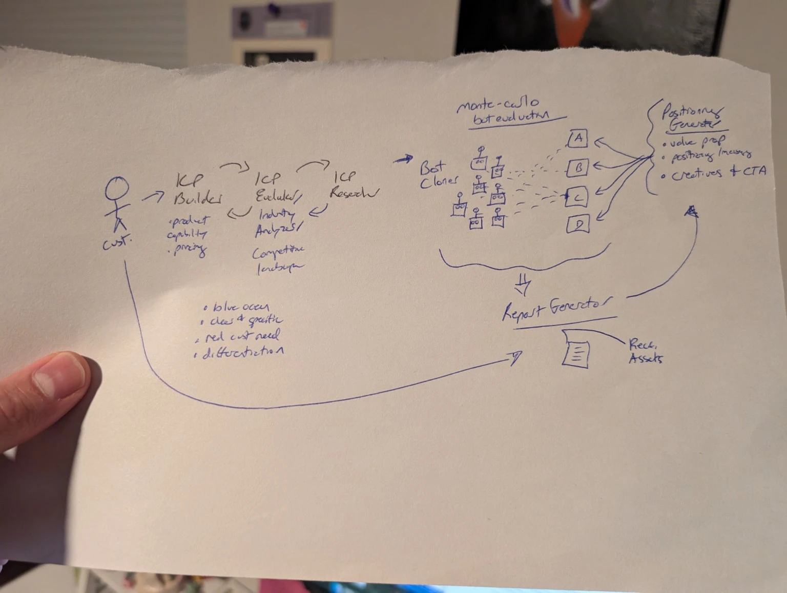

# GTMagic

> Find out who will buy from you, why, and what to say to them, before you spend money on marketing.

GTMagic helps small businesses and founders work out who to sell to and what to say. It researches your market and builds a synthetic audience from **real customer quotes**. It then has that audience choose blind between competing messages, including your current headline. You get three plain answers: who to target, what to say, and what to try this week.

## Status: planning, no code yet

The repo holds the plan and the folder layout. Code starts when the team says go; the kickoff steps are in the Day-0 checklist in [docs/COLLABORATION.md](docs/COLLABORATION.md).

### Planned before the event

The docs in `docs/` (requirements, architecture, data contracts, task split) and the folder READMEs were written before the event as planning. All code is written during the hackathon.

## How one run works

1. **Describe your business:** a description, plus optionally your website, your guess at your best customer, your current headline, and pasted customer reviews or emails. Or click **Try an example**.
2. **Research:** finds customer groups, competitors, and how real customers describe the problem, each with a source link.
3. **Audience:** about 48 synthetic customers, each built from one customer group and "talking like" 3–5 real quotes. It's rebuilt fresh from the evidence on every run, so it never drifts.
4. **Test:** each customer sees 4–6 messages plus your current headline, unbranded and in a balanced order, and picks one or "none of these."
5. **Decide:** a recommendation computed from the counts, including an honest "your guess was right" when it is. Then objections, draft copy, and a ranked list of cheap real-world tests.

Synthetic customers produce **hypotheses to test**, not proof. Every result is labeled that way.

## Docs

| Doc | What's in it |
|---|---|
| [REQUIREMENTS.md](docs/REQUIREMENTS.md) | Who it's for, MVP scope, acceptance criteria, how we score against the judging, open questions |
| [TECH_STACK.md](docs/TECH_STACK.md) | Stack, models, cost and time per run, Claude API facts |
| [ARCHITECTURE.md](docs/ARCHITECTURE.md) | Pipeline, orchestration, failure handling, API, storage, security |
| [CONTRACTS.md](docs/CONTRACTS.md) | The data passed between modules: the team's shared language |
| [TASKS.md](docs/TASKS.md) | Work per owner, checkpoints, demo plan |
| [COLLABORATION.md](docs/COLLABORATION.md) | GitHub workflow, ownership, Day-0 and after-event checklists |

## Team

| Workstream | Owner | Folders |
|---|---|---|
| Platform & Integration (lead) | Nick | `src/contracts`, `src/platform`, `src/app/api` |
| Market Intelligence & Strategy | _TBD_ | `src/modules/market-intelligence`, `src/modules/reporting` |
| Synthetic Audience | _TBD_ | `src/modules/audience` |
| Positioning & Experiments | _TBD_ | `src/modules/positioning`, `src/modules/experiments` |
| Founder Experience (+ pitch, user research) | _TBD_ | `src/app` (UI), `src/components` |

## Running it

_Added when the app is scaffolded at hackathon start._
