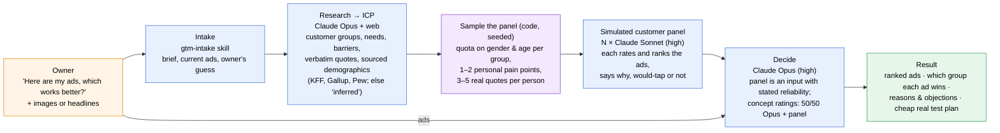
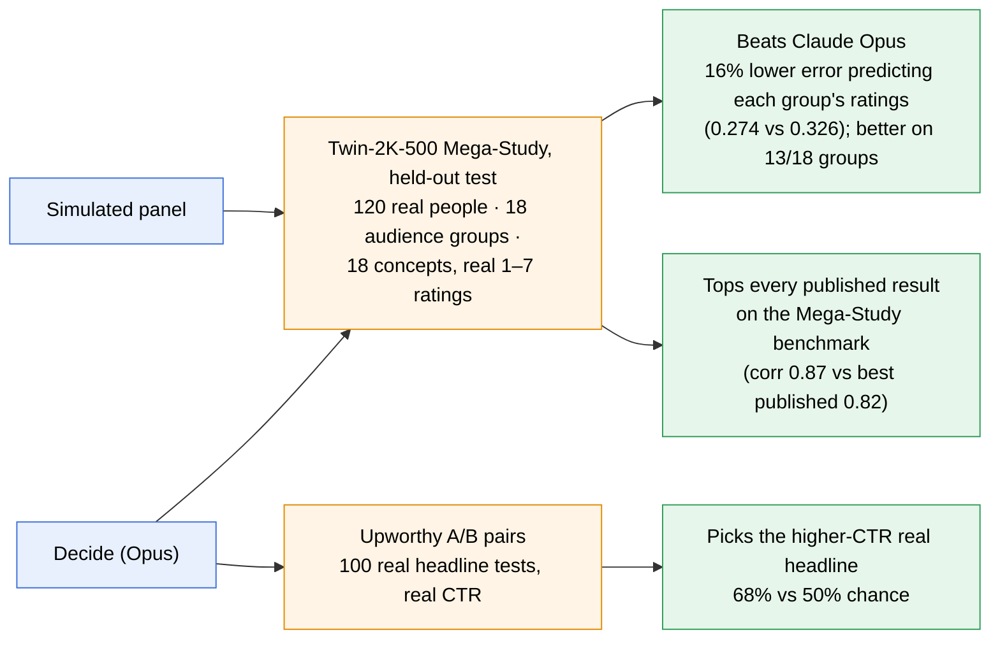

# GTMagic system diagrams

## 1. How a run works

| Stage | Who | Output |
|---|---|---|
| Intake | `gtm-intake` skill | Business brief, the owner's current ads, the owner's guess at the customer |
| Research → ICP | Claude Opus + web search | Customer groups with weights, needs, barriers, verbatim quotes with URLs, sourced demographic distributions |
| Sample | Code (`evals/benchmarks/demographics.py`) | N simulated customers: quota sampling on gender and age, so no model "picks randomly" |
| Simulated panel | Claude Sonnet (high), one per customer | Per-customer rankings and ratings, would-tap, one-line reason |
| Decide | Claude Opus (high) | Final ranking. For concept-level audience ratings, a 50/50 blend of Opus and the panel |

## 2. What we benchmarked and where GTMagic wins

Numbers, data sources and how to reproduce them: [evals/RESULTS.md](../evals/RESULTS.md). Every run, prompt, model and effort level: [evals/benchmarks/RUNLOG.md](../evals/benchmarks/RUNLOG.md).
