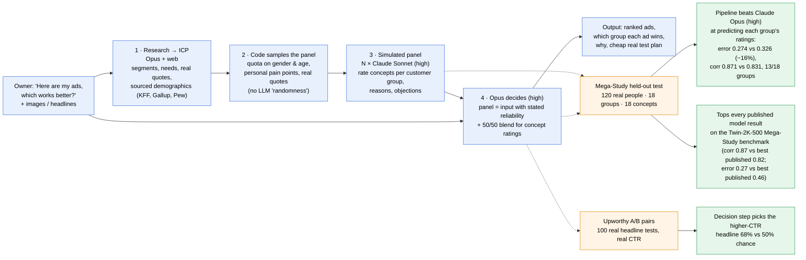

# GTMagic: what we built and what we measured

## Benchmarks run (all Claude, effort high; details in [RUNLOG.md](RUNLOG.md) and [../RESULTS.md](../RESULTS.md))

| Benchmark | Real ground truth | What it tests | Headline result |
|---|---|---|---|
| **Mega-Study** (Twin-2K-500, Apache 2.0) | 300 real US adults' 1–7 ratings of 18 news-post concepts, by demographic group | Panel + decision: how each audience rates different concepts | **Opus + panel beats Opus (high) on the held-out test: MAE −16%, 13/18 groups. Tops all 6 published model results** (re-scored with the same metric) |
| **Upworthy A/B pairs** (OSF, CC BY 4.0) | 100 real headline A/B tests, real CTR | Decision: "which of my two ads?" | Opus decision step 68% vs 50% chance |
