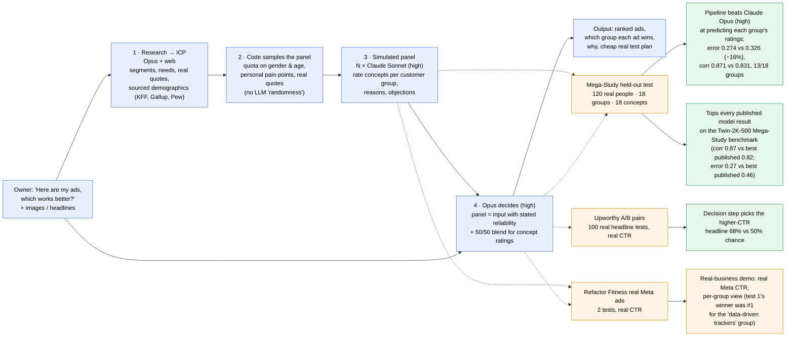

# GTMagic: what we built and what we measured

## Benchmarks run (all Claude; every prompt, model and effort level in [RUNLOG.md](RUNLOG.md))

| Benchmark | Real ground truth | What it tests | Headline result |
|---|---|---|---|
| **Mega-Study** (Twin-2K-500, Apache 2.0) | 300 real US adults' 1–7 ratings of 18 news-post concepts, by demographic group | Panel + decision: how each audience rates different concepts | **Opus + panel beats Opus (high) on the held-out test: MAE −16%, 13/18 groups. Tops all 6 published model results** (re-scored with the same metric) |
| **Upworthy A/B pairs** (OSF, CC BY 4.0) | 100 real headline A/B tests, real CTR | Decision: "which of my two ads?" | Opus decision step 68% vs 50% chance |
| **Upworthy multi-headline** | 400 held-out tests, 4–8 headlines | Decision: rank many ads | Winner in the top 3 picks 86% vs 67% chance |
| **Refactor Fitness Meta ads** | Owner's real impressions, clicks, CTR | End to end on a real small business | Demo: same picks as plain Opus (test 2 correct, test 1 not); the panel's per-group view names test 1's winner for one group |
| Hillstrom e-mail | 64k customers, randomized campaigns | Segment targeting | Data ready, not run |

## Refactor Fitness real results (Meta, owner's dashboard)

| Test | Image | Impressions | Clicks | CTR | CPC |
|---|---|---|---|---|---|
| 1 | **08 your cut, no guesswork** | 2,236 | 22 | **0.98%** | $1.39 |
| 1 | 01 keep your gains | 3,512 | 21 | 0.60% | $1.37 |
| 1 | 10 food fuels your lifts | 2,669 | 15 | 0.56% | $1.37 |
| 1 | 09 weight down, strength intact | 1,989 | 10 | 0.50% | $1.26 |
| 1 | 05 food fuels lifts | 2,837 | 13 | 0.46% | $1.46 |
| 1 | 02 strength, not scale | 0 | 0 | – | – |
| 2 | **c2610d strength + protein (GLP-1 split)** | 2,252 | 15 | **0.67%** | $1.08 |
| 2 | c2610e just eat and lift | 863 | 4 | 0.46% | $1.49 |

Every approach ranked c2610d first in test 2 (correct) and 09 first in test 1; the real winner, 08, was ranked 2nd by plain Opus and by the panel. The panel's "data-driven self-trackers" group ranked 08 first. With 4–22 clicks per ad, neither test's winner is statistically significant (z ≈ 1.7 and 0.7).
